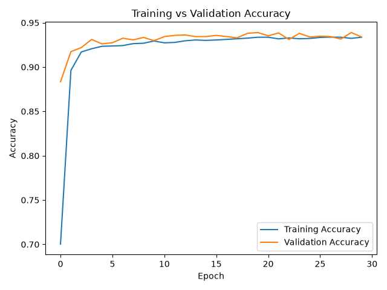
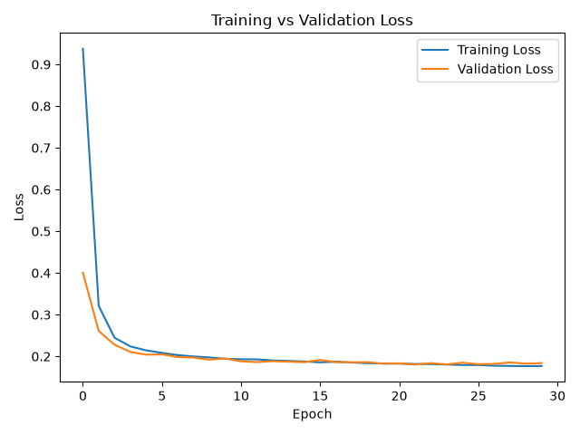

# Dry Bean Classification using Neural Networks

A machine learning project that uses a neural network to classify dry beans into seven different classes based on their physical characteristics.

## Dataset

The Dry Bean Dataset contains 13,611 samples and 16 numerical features.

The seven bean classes are:

- BARBUNYA
- BOMBAY
- CALI
- DERMASON
- HOROZ
- SEKER
- SIRA

## Data Preprocessing

The preprocessing steps include:

- Encoding class labels using LabelEncoder
- Splitting the dataset into training and testing sets
- Using stratified sampling to preserve class distribution
- Standardizing numerical features using StandardScaler

## Neural Network Architecture

The neural network contains:

- Input layer: 16 features
- Hidden layer: 32 neurons with ReLU activation
- Hidden layer: 16 neurons with ReLU activation
- Output layer: 7 neurons with Softmax activation

The model uses:

- Adam optimizer
- Sparse Categorical Crossentropy loss
- 30 training epochs

## Results

The model achieved approximately:

- Test Accuracy: 92.7%
- Macro F1-score: 0.94
- Weighted F1-score: 0.93

The model performed especially well on the BOMBAY, HOROZ, and SEKER classes.

Most classification errors occurred between the DERMASON and SIRA classes.

## Training Performance

### Accuracy

### Loss

## Technologies

- Python
- TensorFlow / Keras
- Pandas
- NumPy
- Scikit-learn
- Matplotlib

## What I Learned

- Building a neural network with TensorFlow and Keras
- Working with multiclass classification
- Using ReLU and Softmax activation functions
- Encoding categorical target labels
- Scaling numerical features
- Training and evaluating neural networks
- Understanding training and validation accuracy
- Using confusion matrices and classification reports